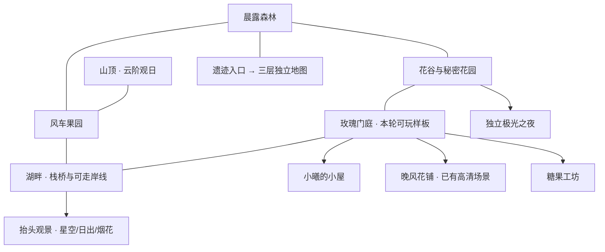

# 曦光庄园 · 全世界重制规划 v1

状态：全世界制作规范与连接规划 + 首个主世界区域「玫瑰门庭」可玩验证。不是宣称全地图已重制；后续区域须经同样的美术与实机验收。

## 当前系统审计

|区域|实际实现/尺寸|交互和碰撞|存档依赖|本轮处理|
|---|---|---|---|---|
|庄园主地图|Manor/game.js，432×850；v5-map.js 合成地面、道路、建筑与植物|固定矩形 blocked，mapHit 坐标点击；四块旧花圃、猫、糖果、门、树、池塘|position、plots、magic、candies、stage|保留原地图/礼物流程；新增独立门庭区域验证新结构|
|晚风花铺|FloristScene；1199×1312 PNG，世界高1280|原图六张透明遮挡；一楼路径与多边形碰撞；售花/包装/装饰|play.flowers/bouquets/furnitureOwned|保持已认可的高清原画与交易，不降质|
|小屋|RomanticScene(cabin)，432×850|家具摆放/旋转/收起、床椅坐下、天气、琴声；home-model 碰撞|romance.room、theme、weather、个人星星|旧玩法全部继续可进入；高清家具逐件重制另列需求|
|秘密花园|RomanticScene(garden)，432×850|六块花圃、浇水/采花、树、秋千、池塘、秘密|romance.beds/flowers/secrets/treeAwakened|保留旧场景；未来与花谷连成户外片区|
|晚风花海|RomanticScene(meadow)，432×850|采花、野餐、坐下、花铺、独立极光入口|play.flowers、romance.flowers、偏好|保留旧场景；未来花谷高清样板|
|湖畔与观景|SkyScene，按视口构图；逻辑绘制宽216、输出432|观星/命名/愿望、流星三编排、烟花、日出、拍照|scenery、romance.starWishes，世界演出偏好侧键|保留全套；户外湖岸未来可走，抬头另入横向风景镜头|
|独立极光|aurora.html，按手机视口|花海进入/返回，隐藏UI、音乐、保存|aurora-navigation 返回点、原偏好|严格独立，不把极光加回普通夜空|
|糖果工坊|CandyHouseScene，432×850|糖果试吃/制作/搅拌/收火、记忆、包装、收藏、服装|shop、favorite、wardrobe|旧交易和小游戏保留；高清柜台与工具另制|
|探宝遗迹|RuinsScene，432×1920，3层，每层3种路线布局|墙/藤门/机关/危险预警/宝箱/临时背包/实体撤离|play.expedition/lastSettlement、adventure|原随机、技能、收益与一次结算规则保留；未来按层单独地图|
|晨露森林、风车果园、山顶|尚无独立可走区域|不能把现有背景山当可走山顶|暂无旧位置可迁移|新区域，需完整素材与碰撞制作，不能以空按钮冒充|

主存档 `xiguang-manor-v1`，version=1；load/sanitize/persist 有损坏保护和导入备份。play 模型负责库存与原子交易，expedition 模型隔离临时/永久战利品，romance.room 保存家具局部坐标。主角是32×40、四方向各4帧；当前大多数区域1.25倍，花铺3倍。音乐为本地 Web Audio；Workbox 只缓存当前构建依赖图。不能把新大地图坐标写回旧 position 的432×850限制。

## 总体布局（设计坐标，不是已完成地图）

全世界以2048单位区域格组织，世界设计范围8192×8192。区域内坐标与全局地理坐标分离，门口ID永久稳定。

区域规划原点：森林(0,2048)、果园(4096,2048)、山顶(6144,1024)、花谷(1024,4096)、门庭(3072,4096)、湖岸(5120,4096)、遗迹入口(0,0)。森林按两格宽4096×2048组织，其余基本片区2048×2048；正式门庭需补足样板东侧768单位的道路/草边过渡，再与湖岸连接。最终世界边界取各区域已制作范围，并不预加载整个8192世界。

门庭→森林/花谷、门庭→湖岸、森林→果园适合连续户外地形与预加载边界；先采用显式区域出口，素材和相邻边缘验收后改成流式无缝连接。建筑室内、遗迹楼层、观星镜头和独立极光保留出入口切换。禁止把多个完整合成场景PNG拼接当世界。

## 统一美术与地图规范

- 以用户高清花铺的木材、瓦片、玻璃、花瓣细节密度为质量目标。温柔晨间奶油金、雾紫、暖木、鼠尾草绿；拒绝用噪点、滤镜或星屑遮盖粗糙主体。
- 户外3/4俯视，同一地面视平角；建筑显示正面和右侧面，窗/门具有厚度。光源左上，接地影右下。室内仍3/4，禁止混入照片或商业游戏截图。
- 新资源PNG原生像素保持清晰，物件按一个倍率缩放，不分别拉伸X/Y。高细节建筑高约300～500世界单位；人物显示约80～100单位，门高约100～130单位。保留旧角色身份，角色细节不足须明确列为缺口。
- 地面层、道路/岸线层、阴影层、可行走实体、按脚底Y排序物件、树冠/屋檐遮挡、稀疏动态、UI分离。每个可互动对象都有稳定ID、图片帧、锚点、脚底碰撞、可达站位、动作；不依靠图片颜色推断碰撞。
- 单区域JSON包含 bounds/spawn/terrain/objects/colliders/portals/interactions；可转换Tiled或Phaser对象层。房屋占地禁行，角色能绕到屋后，树冠按树根Y遮挡，不整张图覆盖主角。
- 模块化建筑/植物/道具图集与地形层为最终资源方式；本轮允许独立的地面绘画层，但建筑、树木、花丛、道路前景、交互物必须独立，不把已合成的房间硬拼到户外。
- 白天优先晨光。四时段最终需要天空、地形、建筑受光、发光窗、植物与水面一起变化；缺夜景/受光变体就如实标注，不用整屏黄/紫遮罩冒充。
- 风采用不同相位小幅变化，树干不移动；阴影贴地。装饰性动画在 reducedMotion/lowEffects 下停用。纹理加载一次，场景离开停止事件和计时器，避免每帧创建Canvas。

## 素材清单与明确缺口

本轮新增主世界住宅/花铺温室外观/糖果工坊外观、树木与花丛透明图集、地面与道路地形层。`src/assets/world/atlas.json`、`GENERATION.json` 记录实际尺寸、哈希、来源及裁切方式，手机验收页的 `assets.json` 汇总文件信息；失败资源不以几何块替代。

后续区域必需PNG，均需统一上述规范并通过实机验收：

|区域|缺少的正式资源|
|---|---|
|全主世界|主门与围墙转角、台阶、路口/石板/泥路/草边/悬崖/岸线过渡图块；建筑屋顶/墙身可拆图层，门开合，灯窗昼夜变体；完整四季植被|
|花谷|cosmos/rose/lily/lavender/sunflower各近中远花簇和生长帧；野餐毯、花篮、花拱门、秋千、蝴蝶停驻帧；晨雾分层|
|晨露森林|橡树/桦树/杉树可拆树冠和树干、枯木、树洞、藤蔓、蕨类、溪流弯道与桥、暗处光斑|
|湖岸|连续岸线和石滩、栈桥头/中/栏杆前景、芦苇、钓鱼动作与浮漂、水纹和可反射遮罩；远中近山脊岩面与森林薄雾|
|风车果园/山顶|风车主体/独立叶片/轮轴、果树与果实收获帧、篱笆/梯田、山路/岩阶、观景平台/云层/晨光变体|
|小屋|按房间透视重绘床/沙发/桌椅/衣柜/书架/琴/灯/窗帘/藤篮；每件包含接地影、翻转/使用/开关帧；墙/地面无家具底板|
|糖果工坊|玻璃柜、糖果罐/瓶水线、包装台/丝带/剪刀、烤炉和搅拌帧、配方与结果图标、柜台前景层、墙地底板|
|遗迹三层|墙体正/侧/顶/破损转角、地砖变体、裂缝/苔藓、石柱/残像/壁画；机关常态/预警/触发帧，宝箱锁扣/箱盖/内部/战利品，出口阶梯；各层差异光源|
|角色|保持原发型服装身份的高细节32×40或等比64×80四向行走/采集/钓鱼/坐姿/手持灯动画；各装备方向锚点，不单纯放大旧图假装精修|

第三方素材逐项核对许可证，保留作者、来源、许可和修改说明。用户发来的商业游戏/网页截图只作参考，不导入发行文件。生成资源记录制作方式，不假称CC0。

## 存档与迁移边界

当前样板保留旧主存档结构、旧位置、室内家具坐标、全部交易及遗迹结算。新区域位置由独立版本化的布局侧档 `xiguang-world-layout-v1` 保存 region/local position，不替换主存档；读坏侧档只回安全出生点，不触碰旧主档。新增采集使用既有花朵库存与原子事务，不改变交易价格；旧花圃状态按原index映射。

全世界展开时：以稳定portal ID保存返回点；旧position只在第一次进入新世界时映射安全入口，不能被新坐标反向覆盖；家具仍是各室内局部坐标，不按世界倍率改动。导入/导出主档须继续有效；侧档是可丢失的位置偏好，不保存货币或物品，不产生复制收益。

## 分区实施与验收顺序

1. 本轮：规范、世界连接图、资源缺口；完成玫瑰门庭可玩样板，并接回当前室内与花园/湖畔。
2. 样板验收后：花谷/晨露森林→湖岸/远山→果园/山顶→室内与糖果工坊→遗迹三层。晚风花铺保留，补二楼须先做干净背景与楼梯遮挡。
3. 每一区先出原生PNG与分层，再建地图/碰撞/交互，最后光影/风/水面与离线测试。不得用空入口或概念图冒充完成。
4. 每阶段都要390×844及375×667真实游戏截图；测试触屏摇杆/寻路/遮挡/出口/重开存档/完全断网，报告真实耗时和局限。实体iPhone无法由WebKit自动化完全代替，不能声称真机验证。

## 本轮样板的真实完成边界

门庭样板使用18个独立素材帧、35个手工布置的物件、独立地形层、实体碰撞和按脚底Y排序的遮挡；通过实际房门进入已完成的花铺、旧小屋和糖果工坊，通过花径接回旧花园、花海与湖畔观景。门庭的四种光照是对各材质、阴影、窗灯与水面分别处理的预览变体，尚非整套重新绘制的四时段地形。新角色高细节动作、全世界可拆屋顶、可走湖岸/森林/山顶、门庭新花圃地块及其空地/幼苗/盛开图集仍缺素材。旧种花系统留在可进入的花园及原庄园，未移除，也不以草簇冒充新花圃。门庭采花沿用原花海的1200毫秒采集间隔及实际库存，没有新定价、体力或NPC。
